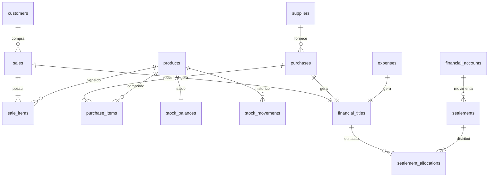

# Arquitetura e regras implementadas

## Limites do sistema

Uma empresa, uma localização de estoque, unidade KG, BRL e uma conta financeira. O dono opera o sistema; o cliente é um cadastro comercial. Fornecedor vende para a empresa; cliente compra da empresa. Confirmação de compra significa recebimento físico; confirmação de venda significa entrega física. A versão inicial grava diretamente documentos confirmados.

## Modelo relacional

O esquema executável, com tipos, chaves, índices e CHECKs, está em `backend/src/main/resources/db/migration/V1__estrutura_inicial.sql`. Não editar migrações já aplicadas: novas mudanças devem receber nova versão.

A V2 torna `purchases.supplier_id` opcional, ajusta a origem dos títulos e adiciona `business_guard` e `period_closures`. Uma compra sem fornecedor continua gerando dívida e pode receber pagamentos parciais. Não é agrupada com outras compras anônimas em um pagamento único, pois não há contraparte identificada.

## Fechamentos e fronteira transacional

Antes dos lançamentos, a transação adquire `business_guard` e confere o dia em America/Bahia. O fechamento adquire o mesmo bloqueio antes de validar sobreposições e capturar os registros. Isso serializa os comandos financeiros/estoque desta empresa, definindo se uma operação entra no snapshot ou é recusada. Não houve benchmark de throughput; a prioridade desta implementação é consistência para uma operação de pequeno porte.

`period_closures` preserva intervalo inclusivo, horário UTC, autor, fuso, observação, versão do formato, JSON e SHA-256. Usa LONGTEXT com JSON_VALID para preservar os bytes originais (o tipo JSON do MySQL pode reordená-los). O download devolve esses bytes, e as leituras verificam o hash.

A captura usa consultas sequenciais na mesma transação: relatório/estoque final, documentos e itens do período, movimentos, pagamentos/alocações e posição dos títulos até a data final. Nomes e códigos são copiados; alterações de cadastro futuras não alteram o conteúdo preservado. Pagamentos posteriores não recalculam as posições antigas.

Não há reabertura, edição ou exclusão de snapshots. Triggers rejeitam UPDATE/DELETE. SHA-256 verifica integridade e não representa assinatura digital; um administrador com controle completo do banco continua tendo poder sobre o esquema e o armazenamento. O Compose permite criar os triggers sem conceder SUPER à aplicação.

Fechar um período anterior não bloqueia o dia seguinte fora dele. Repetir uma requisição idempotente já concluída retorna o mesmo ID mesmo após fechar; isso não cria outro lançamento. Cadastros continuam editáveis porque o snapshot já contém seus valores copiados.

`AutomaticClosingScheduler` agenda `23:59:00` em America/Bahia e faz uma verificação adicional ao iniciar e a cada 60 segundos para recuperação de falhas. O publisher é reativo e adiado; cada assinatura lê horário e banco novamente. Referência: [agendamento reativo do Spring](https://docs.spring.io/spring-framework/reference/integration/scheduling.html).

A V4 cria `automatic_closing_state.next_date`, inicializado no primeiro dia em que a automação executar. O cursor evita criar fechamentos retroativos anteriores à ativação. Cada dia pendente é processado em uma transação própria: adquire o mesmo `business_guard`, preserva o snapshot com o autor `Sistema (automático)` e avança o cursor. Se a transação falhar, nenhum dos dois é confirmado. Dias já cobertos por um fechamento manual são pulados sem alterar seus bytes. O bloqueio compartilhado também impede duplicação entre execuções simultâneas ou múltiplas instâncias.

`PeriodGuard` recusa novos lançamentos a partir das 23h59 mesmo se o agendador estiver atrasado ou a captura ainda não tiver confirmado. Na virada do dia, volta a admitir lançamentos na nova data. `Clock` injetável fornece o horário UTC, convertido para America/Bahia tanto no agendamento quanto no bloqueio e no status. O status informa `automaticClosingPending=true` entre o corte e a preservação do snapshot; a interface mostra esse estado e atualiza a lista de fechamentos a cada minuto.

Quando o servidor ficar desligado, o processamento dos dias pendentes retoma pelo cursor persistido. Dias sem movimento também geram snapshots; `closed_at` registra o instante real da captura, sem simular execução passada. Não há dependência de navegador, sessão de usuário ou chamada HTTP para acionar a automação.

## Consistência

- Cada comando operacional é uma transação reativa no MySQL. Não há `block()`, `subscribe()` manual ou JDBC no caminho das requisições.
- Cabeçalho, itens, custo, estoque, título e pagamento imediato são confirmados juntos.
- Produtos são processados por ID crescente; os saldos são bloqueados com `FOR UPDATE`. Títulos também são bloqueados em ordem crescente.
- Cadastros utilizados são verificados como ativos dentro da transação, com leitura bloqueante no banco (o driver permanece não bloqueante para a aplicação).
- Cada comando usa `Idempotency-Key`: a tabela `operation_requests` guarda tipo, hash do payload, autor e ID do resultado na mesma transação. Repetir chave/payload retorna o mesmo resultado; chave com payload diferente gera 409.
- Conflitos transitórios retornam 409; o cliente pode reenviar a mesma chave. O formulário preserva a chave para uma repetição do mesmo conteúdo após falha de rede.
- Sem exclusão de documentos e sem alteração silenciosa dos saldos. Cadastro pode ser editado ou inativado.

## Precisão

Quantidades `DECIMAL(14,3)`, preços e valores de custo `DECIMAL(19,6)`, dinheiro `DECIMAL(19,2)`. Java usa `BigDecimal`; total de cada item arredondado HALF_UP a centavos. O total do documento é a soma desses itens. Front-end apenas exibe estimativas; servidor é a autoridade.

Custo médio móvel: a compra soma quilos e custo ao estoque. Uma saída proporcional consome o valor de estoque correspondente e salva esse custo no item da venda. A saída que esgota o produto consome todo o valor restante, eliminando resíduos de arredondamento. Perdas usam o mesmo custo e são deduzidas separadamente do resultado gerencial.

## Financeiro

Toda venda gera um título RECEIVABLE, inclusive se quitada imediatamente. Compras e despesas geram PAYABLE. Pagamento é um registro separado, com uma ou mais alocações em títulos da mesma natureza e contraparte. O total pago é calculado pela soma das alocações; o sistema bloqueia excedentes e títulos repetidos.

Saldo devedor é derivado: valor dos títulos menos alocações. Não há campo de saldo editável no cliente. Recebimento não cria venda nem movimenta estoque. Pagamentos são informados manualmente: selecionar Pix ou cartão **não inicia cobrança bancária**.

## Relatórios

Intervalo inclusivo por dias no fuso America/Bahia convertido para intervalo UTC `[início, dia seguinte ao fim)`. Datas operacionais são geradas no servidor; vencimento é uma data civil informada pelo usuário.

- Receita e CMV: vendas realizadas no período.
- Despesas: data do registro, mesmo se não pagas.
- Resultado gerencial: receita − CMV − despesas − perdas.
- Fluxo de caixa: recebimentos − pagamentos efetivos no período.
- Estoque final: soma histórica dos movimentos anteriores ao fim selecionado.
- Contas abertas na data final: títulos emitidos até aquela data menos pagamentos realizados até ela. Pagamentos posteriores não alteram o relatório de um período anterior.
- Saldo financeiro acumulado: soma dos lançamentos, iniciado em zero. Não equivale ao saldo bancário se existirem operações externas ao sistema.

A consulta inteira usa uma transação somente de leitura e o isolamento padrão do MySQL/InnoDB, oferecendo uma visão consistente do relatório.

## Autenticação e execução

Administrador único carregado do ambiente; senha BCrypt, sessão WebFlux, CSRF em login e comandos, logout por POST. O front-end não armazena credenciais. Os containers locais têm escopo de rede próprio e os endpoints publicados são limitados ao loopback do computador. Para produção: HTTPS, cookies Secure, gestão de usuários, limitação de tentativas, gestão de segredos, backup/restore e monitoramento.

## Próximas etapas do produto

1. Cancelamentos e devoluções, com estorno financeiro e política de recomposição/recalculo de custo; sem deletar o histórico.
2. Ajustes posteriores auditados que preservem os períodos já fechados.
3. Avaliação de índices e estratégia de busca conforme o volume real de uso.
4. Usuários, perfis e auditoria de alterações dos cadastros (os lançamentos já registram autor).
5. Lotes e validade, saldos iniciais, aportes/retiradas e múltiplas contas.
6. Parcelas, frete de aquisição rateado, pedidos/reservas e emissão fiscal, conforme necessidade.

## Desconto e migração V3

`sales.gross_total` preserva a soma dos subtotais dos itens, `discount_amount` é o desconto global e `total` é o líquido. A V3 preenche os documentos antigos com `gross_total=total` e desconto zero; títulos, pagamentos e snapshots anteriores não são reescritos.

O servidor valida o desconto em reais/centavos, de zero ao subtotal. Títulos e pagamentos usam o líquido. CMV e valorização do estoque não recebem desconto. Itens continuam com seus subtotais brutos, sem rateio do desconto por item. Em desconto integral, o documento de total zero movimenta estoque e registra custo, sem criar título/pagamento de valor zero.

`gross_revenue` e `discounts` complementam `revenue` (líquida) no relatório. Novos snapshots têm formato 2 e contêm esses indicadores e os campos de cada venda; versões anteriores continuam legíveis com o conteúdo/hash preservados.

## Paginação

`Sql.page` compõe contagem, agregações e consulta limitada em uma transação reativa de leitura. São usados limites e deslocamentos vinculados por parâmetros, com ordenação fixa e ID como desempate. Tamanho padrão 20, máximo 100. As buscas são parametrizadas e escapam curingas de LIKE.

O envelope contém itens, página, tamanho, total, total de páginas, indicadores de navegação e um resumo de todos os registros do filtro. O financeiro e os extratos usam esses resumos para não apresentar como saldo total a soma apenas da página.

A interface mantém paginações independentes por lista, reinicia a página quando mudam a busca, tamanho ou filtro e ignora respostas de buscas anteriores. Os seletores pesquisam remotamente, preservando a opção selecionada ao navegar. O painel consulta somente cinco itens para suas prévias; indicadores continuam baseados no relatório completo.

Snapshots usam paginação local apenas na renderização dos dados imutáveis; captura e download mantêm todos os registros. O estoque do relatório é paginado na tela e integral na impressão.
