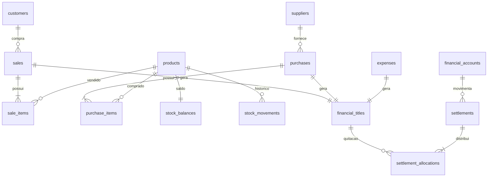

# Arquitetura e regras implementadas

## Limites do sistema

Uma empresa, uma localização de estoque, unidade KG, BRL e uma conta financeira. O dono opera o sistema; o cliente é um cadastro comercial. Fornecedor vende para a empresa; cliente compra da empresa. Confirmação de compra significa recebimento físico; confirmação de venda significa entrega física. A versão inicial grava diretamente documentos confirmados.

## Modelo relacional

O esquema executável, com tipos, chaves, índices e CHECKs, está em `backend/src/main/resources/db/migration/V1__estrutura_inicial.sql`. Não editar migrações já aplicadas: novas mudanças devem receber nova versão.

A V2 torna `purchases.supplier_id` opcional, ajusta a origem dos títulos e adiciona `business_guard` e `period_closures`. Uma compra sem fornecedor continua gerando dívida e pode receber pagamentos parciais. Não é agrupada com outras compras anônimas em um pagamento único, pois não há contraparte identificada.

## Fechamentos e fronteira transacional

Antes dos lançamentos, a transação adquire `business_guard` e confere o dia em America/Bahia. O fechamento adquire o mesmo bloqueio antes de validar sobreposições e capturar os registros. Isso serializa os comandos financeiros/estoque desta empresa, definindo se uma operação entra no snapshot ou é recusada. Não houve benchmark de throughput; a prioridade desta implementação é consistência para uma operação de pequeno porte.

`period_closures` preserva intervalo inclusivo, horário UTC, autor, fuso, observação, versão do formato, JSON e SHA-256. Usa LONGTEXT com JSON_VALID para preservar os bytes originais (o tipo JSON do MySQL pode reordená-los). O download devolve esses bytes, e as leituras verificam o hash.

A captura usa consultas sequenciais na mesma transação: relatório/estoque final, documentos e itens do período, movimentos, pagamentos/alocações e posição dos títulos até a data final. Nomes e códigos são copiados; alterações de cadastro futuras não alteram o conteúdo preservado. Pagamentos posteriores não recalculam as posições antigas.

Não há reabertura, edição ou exclusão de snapshots. Triggers rejeitam UPDATE/DELETE. SHA-256 verifica integridade e não representa assinatura digital; um administrador com controle completo do banco continua tendo poder sobre o esquema e o armazenamento. O Compose permite criar os triggers sem conceder SUPER à aplicação.

Fechar um período anterior não bloqueia o dia seguinte fora dele. Repetir uma requisição idempotente já concluída retorna o mesmo ID mesmo após fechar; isso não cria outro lançamento. Cadastros continuam editáveis porque o snapshot já contém seus valores copiados.

## Consistência

- Cada comando operacional é uma transação reativa no MySQL. Não há `block()`, `subscribe()` manual ou JDBC no caminho das requisições.
- Cabeçalho, itens, custo, estoque, título e pagamento imediato são confirmados juntos.
- Produtos são processados por ID crescente; os saldos são bloqueados com `FOR UPDATE`. Títulos também são bloqueados em ordem crescente.
- Cadastros utilizados são verificados como ativos dentro da transação, com leitura bloqueante no banco (o driver permanece não bloqueante para a aplicação).
- Cada comando usa `Idempotency-Key`: a tabela `operation_requests` guarda tipo, hash do payload, autor e ID do resultado na mesma transação. Repetir chave/payload retorna o mesmo resultado; chave com payload diferente gera 409.
- Conflitos transitórios retornam 409; o cliente pode reenviar a mesma chave. O formulário preserva a chave para uma repetição do mesmo conteúdo após falha de rede.
- Sem exclusão de documentos e sem alteração silenciosa dos saldos. Cadastro pode ser editado ou inativado.

## Precisão

Quantidades `DECIMAL(14,3)`, preços e valores de custo `DECIMAL(19,6)`, dinheiro `DECIMAL(19,2)`. Java usa `BigDecimal`; total de cada item arredondado HALF_UP a centavos. O total do documento é a soma desses itens. Front-end apenas exibe estimativas; servidor é a autoridade.

Custo médio móvel: a compra soma quilos e custo ao estoque. Uma saída proporcional consome o valor de estoque correspondente e salva esse custo no item da venda. A saída que esgota o produto consome todo o valor restante, eliminando resíduos de arredondamento. Perdas usam o mesmo custo e são deduzidas separadamente do resultado gerencial.

## Financeiro

Toda venda gera um título RECEIVABLE, inclusive se quitada imediatamente. Compras e despesas geram PAYABLE. Pagamento é um registro separado, com uma ou mais alocações em títulos da mesma natureza e contraparte. O total pago é calculado pela soma das alocações; o sistema bloqueia excedentes e títulos repetidos.

Saldo devedor é derivado: valor dos títulos menos alocações. Não há campo de saldo editável no cliente. Recebimento não cria venda nem movimenta estoque. Pagamentos são informados manualmente: selecionar Pix ou cartão **não inicia cobrança bancária**.

## Relatórios

Intervalo inclusivo por dias no fuso America/Bahia convertido para intervalo UTC `[início, dia seguinte ao fim)`. Datas operacionais são geradas no servidor; vencimento é uma data civil informada pelo usuário.

- Receita e CMV: vendas realizadas no período.
- Despesas: data do registro, mesmo se não pagas.
- Resultado gerencial: receita − CMV − despesas − perdas.
- Fluxo de caixa: recebimentos − pagamentos efetivos no período.
- Estoque final: soma histórica dos movimentos anteriores ao fim selecionado.
- Contas abertas na data final: títulos emitidos até aquela data menos pagamentos realizados até ela. Pagamentos posteriores não alteram o relatório de um período anterior.
- Saldo financeiro acumulado: soma dos lançamentos, iniciado em zero. Não equivale ao saldo bancário se existirem operações externas ao sistema.

A consulta inteira usa uma transação somente de leitura e o isolamento padrão do MySQL/InnoDB, oferecendo uma visão consistente do relatório.

## Autenticação e execução

Administrador único carregado do ambiente; senha BCrypt, sessão WebFlux, CSRF em login e comandos, logout por POST. O front-end não armazena credenciais. Os containers locais têm escopo de rede próprio e os endpoints publicados são limitados ao loopback do computador. Para produção: HTTPS, cookies Secure, gestão de usuários, limitação de tentativas, gestão de segredos, backup/restore e monitoramento.

## Próximas etapas do produto

1. Cancelamentos e devoluções, com estorno financeiro e política de recomposição/recalculo de custo; sem deletar o histórico.
2. Ajustes posteriores auditados que preservem os períodos já fechados.
3. Paginação e busca de cadastros/documentos/títulos no servidor.
4. Usuários, perfis e auditoria de alterações dos cadastros (os lançamentos já registram autor).
5. Lotes e validade, saldos iniciais, aportes/retiradas e múltiplas contas.
6. Descontos explícitos, parcelas, frete de aquisição rateado, pedidos/reservas e emissão fiscal, conforme necessidade.
